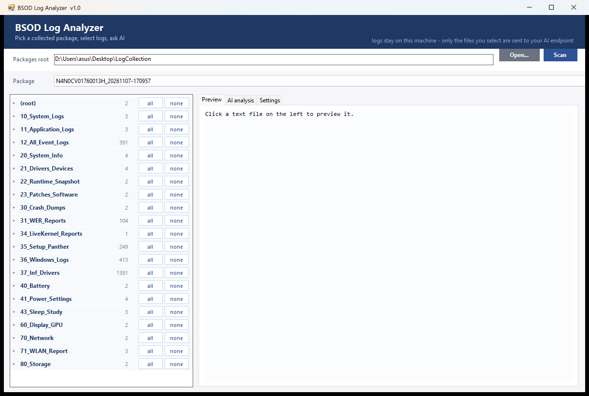

# BSOD Log Analyzer

A desktop tool for reading the packages produced by **Laptop Log Collector** and asking an AI model
to analyse the log files you select.

It is the same collector workflow as before - pick a package, tick the logs, ask a question - but as a
native Windows application instead of a local web page. Nothing runs in a browser and no local web
server is started.



## What it does

- **Package list** - scans a folder (default `Desktop\LogCollection`) for packages produced by the
  collector, i.e. folders containing `report.html` or `Collection_Info.txt`
- **Log tree** - grouped by the collector's `10_..`, `20_..`, `30_..` folders, with
  - a checkbox per text file,
  - `all` / `none` buttons per folder,
  - click a file name to preview it (UTF-8 / UTF-16 / GBK are detected automatically)
  - `.evtx` and `.dmp` are shown greyed out: they are binary and are never sent to the model
- **AI analysis** - `Analyze` sends the ticked files and the model answers **in Chinese**; the answer
  is rendered below with headings and bullets, and can be copied or exported as a .txt file
- Select what to send with the checkboxes on the left

## AI settings

`Settings` tab:

| Field | Meaning |
|---|---|
| Endpoint | any OpenAI-compatible base URL: `https://api.deepseek.com/v1`, `https://api.openai.com/v1`, `http://localhost:11434/v1` for Ollama |
| API key | stored encrypted with Windows DPAPI for the current user, never written in clear text |
| Model | e.g. `deepseek-chat`, `gpt-4o-mini`, `qwen2.5:14b` |
| Characters per file / total | default 2,000,000 and 15,000,000; lower them if your model has a small context window |

Only the text you select is sent, and only to the endpoint you typed in. Nothing else leaves the machine.

## Build

Requires nothing but the .NET Framework compiler shipped with Windows:

```powershell
.\build.ps1
```

Output: `build\BsodAnalyzer.exe` (single file, ~40 KB, no runtime install needed).

## Command line

```
BsodAnalyzer.exe                     # normal UI
BsodAnalyzer.exe --selftest <package> <endpoint> <key> <model> [outfile]
```

`--selftest` runs one analysis without the UI and writes the result to a text file - useful for
checking an API key or a proxy from a script.

## Notes

- `.evtx` and `.dmp` cannot be parsed here; analyse them with Event Viewer and WinDbg. The collector
  already writes `key_events.csv`, which the AI can read.
- Very large files are truncated (default 20,000 characters per file).
- The AI only sees the files you ticked; it cannot open anything else on disk.

## History

v1.0 is the first release of the desktop application. Earlier versions were a local web UI that
shipped inside the `Windows_Log_App` repository; this repository replaces it.
